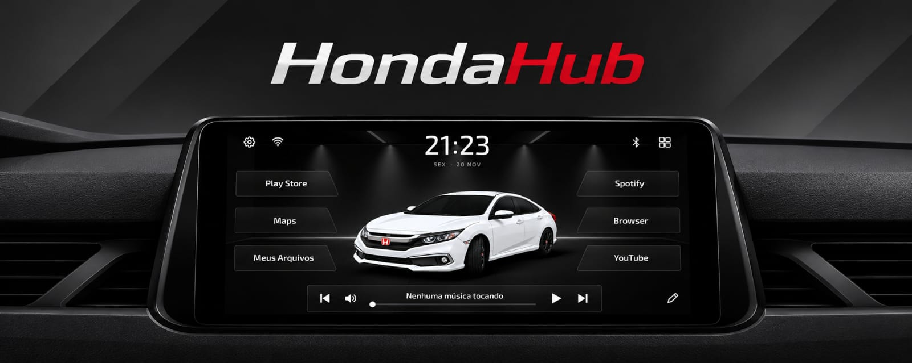



## Stack


-3DDC84?logo=android&logoColor=white)


**Kotlin + Android SDK puro.** Nenhuma biblioteca externa (nem AppCompat, nem Jetpack), para rodar leve até em centrais multimídia antigas e fracas.

## Funcionalidades

- **Tela inicial de carro**: relógio grande, o Civic numa garagem iluminada e 6 atalhos de apps em vidro, com tudo posicionado como no modelo.
- **Atalhos inteligentes**: os 6 botões se preenchem sozinhos (Play Store primeiro, depois os apps baixados), ou você escolhe o app de cada um.
- **Gaveta de apps**: todos os apps da central com filtros *Todos / Baixados / Do sistema*. Um toque abre o app.
- **Player de música**: tocar, pausar, avançar, voltar, mudo e barra de progresso para qualquer app de música da central (Spotify, YouTube Music, rádio…).
- **14 garagens**: papéis de parede em cores diferentes, desenhados com a mesma perspectiva da foto do carro. Botões e relógio acompanham a cor escolhida.
- **Painel Personalizar** (lápis): prévia ao vivo da tela para trocar os apps dos botões e o papel de parede.
- **Tela de boas-vindas**: logo da Honda com reflexo de luz e "Bem-vindo a bordo" enquanto o app carrega.
- **Atalhos do sistema**: ajustes do Android, Wi-Fi e Bluetooth direto da tela inicial.
- **Funciona como tela inicial**: o Android oferece o HondaHub no botão Home, e o Voltar nunca sai dele.

## Tecnologias

| Parte | Como é feita |
|---|---|
| Interface | `View`s próprias desenhadas no `Canvas` (botões em trapézio, ícones, player, relógio), sem XML de layout |
| Layout | coordenadas do modelo de 1358 x 681 escaladas para a tela real (`Tela`) |
| Música | `MediaSessionManager` + `NotificationListenerService` (Android 5+) e teclas de mídia nas versões antigas |
| Lista de apps | `PackageManager` + `GridView` reciclável, com ícones convertidos em imagem uma vez só, em segundo plano |
| Imagens | `BitmapFactory` com `inSampleSize` e `RGB_565`, decodificando numa thread só, fora da tela |
| Preferências | `SharedPreferences` (app de cada botão e papel de parede) |
| Fontes | Exo 2 (textos) e Orbitron (título da boas-vindas), embutidas em `assets/fontes` |
| Ferramentas | scripts Java que geram as garagens (ray tracing simples da sala) e o ícone do app |

**Desempenho**: os painéis são montados uma vez quando o app fica ocioso e depois só aparecem e somem. Cada toque atualiza apenas o que mudou, e a tela inicial é escondida enquanto um painel está aberto.

## Arquitetura / Estrutura

```
app/src/main/java/com/multimidiacivic/launcher/
├── MainActivity.kt       monta a tela inicial e liga tudo (splash, painéis, música, apps)
├── tela/                 peças da tela inicial
│   ├── Tela.kt           posiciona as peças pelas coordenadas do modelo
│   ├── Splash.kt         boas-vindas enquanto a tela carrega
│   ├── Fundo.kt          papel de parede (garagem) escolhido
│   ├── Carro.kt          foto do carro + sombra
│   ├── Botao.kt          botões em trapézio de vidro (tingidos pela cor da garagem)
│   ├── Icone.kt          ícones desenhados no código
│   ├── Relogio.kt        relógio e data
│   └── Player.kt         caixa do player de música
├── editor/Editor.kt      painel Personalizar (lápis): apps dos botões e papel de parede
├── gaveta/Gaveta.kt      gaveta com todos os apps (botão de grade)
├── musica/Musica.kt      controle da música dos outros apps (+ OuvinteNotificacoes)
├── dados/
│   ├── Apps.kt           lista os apps instalados e distribui nos 6 botões
│   └── Temas.kt          garagens disponíveis + o que fica salvo (Ajustes)
└── util/
    ├── Pecas.kt          textos, botões, caixas e grade de apps comuns aos painéis
    ├── Icones.kt         ícones dos apps prontos como imagem
    ├── Imagens.kt        decodificação de imagens em segundo plano
    └── Fontes.kt         fontes carregadas uma vez só

app/src/main/res/
├── drawable-nodpi/       carro.png, logo.png (splash) e fundo_<cor>.jpg (garagens)
└── mipmap-*/             ícone do app em todos os tamanhos

ferramentas/
├── GerarFundos.java      gera as 14 garagens casadas com a perspectiva do carro
├── GerarIcone.java       gera o ícone do app a partir de logo-app.png
└── setup-ambiente.ps1    instala JDK, Android SDK e scrcpy
```

## Como rodar

### 1. Ambiente (só uma vez)

No terminal do VS Code (PowerShell), dentro da pasta do projeto:

```powershell
powershell -ExecutionPolicy Bypass -File ferramentas\setup-ambiente.ps1
```

Ele instala na sua pasta de usuário, sem precisar ser administrador:

| O quê | Onde |
|---|---|
| JDK 17 | `%LOCALAPPDATA%\Android\jdk-17` |
| Android SDK (adb, android-34, build-tools 34) | `%LOCALAPPDATA%\Android\Sdk` |
| `JAVA_HOME`, `ANDROID_HOME` e `PATH` | variáveis do seu usuário |
| scrcpy (espelhar a tela no PC) | via winget |

Depois, feche e abra o VS Code. O Gradle não precisa ser instalado: o `gradlew.bat` baixa sozinho.

### 2. Aparelho (celular ou central)

1. Configurações > Sobre > toque 7 vezes em **Número da versão** para liberar o modo desenvolvedor.
2. Opções do desenvolvedor > ligue **Depuração USB**.
3. Conecte um cabo **de dados** e aceite **"Permitir depuração USB"** na tela.

### 3. Compilar, instalar e abrir

```powershell
.\rodar.ps1            # versão de teste
.\rodar.ps1 -Release   # versão final otimizada (bem menor)
```

Também funciona com dois cliques em `rodar.bat` ou **Ctrl+Shift+B** no VS Code. O script compila, espera o aparelho por até 30 s, instala e abre o app, e explica o que fazer se algo falhar (aparelho não autorizado, offline, assinatura diferente…).

- Ver a tela no PC: Terminal > Executar Tarefa > **Espelhar tela (scrcpy)**
- Se o app fechar sozinho: Terminal > Executar Tarefa > **Ver erros do app (logcat)**

### 4. Instalar no carro pelo navegador

Gere a versão final com `.\rodar.ps1 -Release` e envie `app\build\outputs\apk\release\app-release.apk` para a central (Google Drive, por exemplo). Na central, autorize o navegador a instalar apps e, no primeiro toque no botão Home, escolha **HondaHub > Sempre**.

Para o nome e o progresso da música aparecerem, toque no nome da música no player e libere **Acesso a notificações** uma vez.

### Personalizar as imagens

| O quê | Como |
|---|---|
| Foto do carro | substitua `res\drawable-nodpi\carro.png` (PNG com fundo transparente) e refaça as garagens |
| Garagens | `java ferramentas\GerarFundos.java`; para conferir o encaixe com o carro, rode com `-Dcor=azul ... conferir --conferir` |
| Cor nova de garagem | uma linha em `TEMAS` no `GerarFundos.java` e a mesma cor em `dados/Temas.kt` |
| Logo da splash | `res\drawable-nodpi\logo.png`; tamanho, acabamento e textos em `tela/Splash.kt` |
| Ícone do app | substitua `ferramentas\logo-app.png` e rode `java ferramentas\GerarIcone.java` (cores, giro e tamanho no topo do arquivo) |

Use o `java.exe` do JDK instalado: `& "$env:LOCALAPPDATA\Android\jdk-17\bin\java.exe" ferramentas\GerarIcone.java`.

---

<p align="center">Feito por <b>@borgeizdev</b></p>
