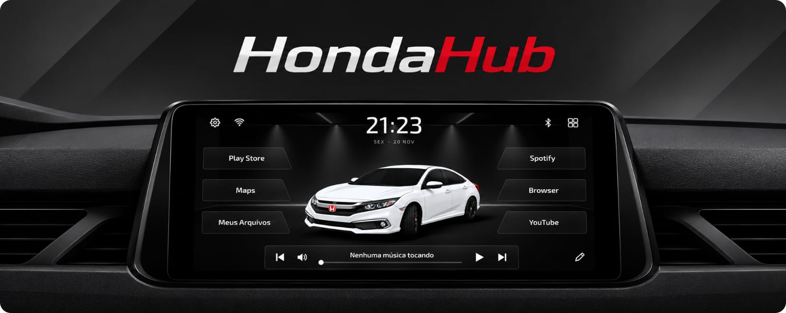

<p align="center">
  
</p>

<p align="center">
  <a href="#stack"><b>Stack</b></a> ·
  <a href="#funcionalidades"><b>Funcionalidades</b></a> ·
  <a href="#arquitetura--estrutura"><b>Estrutura</b></a> ·
  <a href="#como-rodar"><b>Como rodar</b></a>
</p>

<br>

## Stack

<p align="center">
  <a href="https://skillicons.dev">
    
  </a>
</p>

<p align="center">
  <a href="https://kotlinlang.org"><b>Kotlin</b></a> ·
  <a href="https://developer.android.com"><b>Android SDK</b></a> ·
  <a href="https://gradle.org"><b>Gradle</b></a> ·
  <a href="https://openjdk.org"><b>Java 17</b></a>
</p>

<p align="center">
  Android puro + Kotlin, <b>sem nenhuma biblioteca externa</b>, para rodar leve até em centrais antigas (Android 4.2+).
</p>

## Funcionalidades

| | |
|---|---|
| **Tela inicial de carro** | relógio com data, o Civic numa garagem iluminada e 6 atalhos de apps em vidro, tudo nas posições do modelo |
| **Atalhos inteligentes** | os 6 botões se preenchem sozinhos (Play Store primeiro, depois os apps baixados), ou você escolhe o app de cada um |
| **Gaveta de apps** | o botão de grade abre todos os apps da central, com filtros *Todos*, *Baixados* e *Do sistema* |
| **Player de música** | tocar, pausar, avançar, voltar, mudo e barra de progresso para qualquer app de música (Spotify, YouTube Music…) |
| **14 garagens** | papéis de parede renderizados na mesma perspectiva da foto do carro; botões e relógio acompanham a cor escolhida |
| **Personalizar** | o lápis abre um painel com prévia ao vivo para trocar os apps dos botões e o papel de parede |
| **Boas-vindas** | logo da Honda com reflexo de luz e *"Bem-vindo a bordo"* enquanto o app carrega |
| **Atalhos do sistema** | ajustes do Android, Wi-Fi e Bluetooth direto da tela inicial |
| **Launcher de verdade** | vira a tela inicial no botão Home do Android, e o Voltar nunca sai dela |
| **Leve** | painéis montados uma vez só, grade de apps reciclável e imagens lidas no tamanho da tela, para não travar em central fraca |

## Arquitetura / Estrutura

<details>
<summary><b>Ver estrutura de pastas</b></summary>
<br>

```
app/src/main/java/com/multimidiacivic/launcher/
├── MainActivity.kt       monta a tela inicial e liga tudo (splash, painéis, música, apps)
├── tela/                 peças da tela inicial
│   ├── Tela.kt           posiciona as peças pelas coordenadas do modelo (1358 × 681)
│   ├── Splash.kt         boas-vindas enquanto a tela carrega
│   ├── Fundo.kt          papel de parede (garagem) escolhido
│   ├── Carro.kt          foto do carro + sombra
│   ├── Botao.kt          botões em trapézio de vidro, tingidos pela cor da garagem
│   ├── Icone.kt          ícones desenhados no código
│   ├── Relogio.kt        relógio e data
│   └── Player.kt         caixa do player de música
├── editor/Editor.kt      painel Personalizar (lápis): apps dos botões e papel de parede
├── gaveta/Gaveta.kt      gaveta com todos os apps (botão de grade)
├── musica/Musica.kt      controle da música dos outros apps (+ OuvinteNotificacoes)
├── dados/
│   ├── Apps.kt           lista os apps instalados e distribui nos 6 botões
│   └── Temas.kt          garagens disponíveis + o que fica salvo (Ajustes)
└── util/
    ├── Pecas.kt          textos, botões, caixas e grade de apps comuns aos painéis
    ├── Icones.kt         ícones dos apps prontos como imagem
    ├── Imagens.kt        decodificação de imagens em segundo plano
    └── Fontes.kt         fontes Exo 2 e Orbitron, carregadas uma vez só

app/src/main/res/
├── drawable-nodpi/       carro.png, logo.png (splash) e fundo_<cor>.jpg (garagens)
└── mipmap-*/             ícone do app em todos os tamanhos

ferramentas/
├── GerarFundos.java      renderiza as 14 garagens casadas com a perspectiva do carro
├── GerarIcone.java       gera o ícone do app a partir de logo-app.png
└── setup-ambiente.ps1    instala JDK, Android SDK e scrcpy
```

</details>

## Como rodar

<details>
<summary><b>Ver passo a passo</b></summary>
<br>

### 1. Ambiente <sub>(só uma vez)</sub>

No terminal do VS Code (PowerShell), dentro da pasta do projeto:

```powershell
powershell -ExecutionPolicy Bypass -File ferramentas\setup-ambiente.ps1
```

Instala na sua pasta de usuário, **sem precisar ser administrador**: JDK 17, Android SDK (adb, android-34, build-tools 34), as variáveis `JAVA_HOME` / `ANDROID_HOME` e o [scrcpy](https://github.com/Genymobile/scrcpy) para espelhar a tela. Depois, feche e abra o VS Code. O Gradle baixa sozinho pelo `gradlew.bat`.

### 2. Aparelho

1. Configurações › Sobre › toque **7 vezes** em *Número da versão* para liberar o modo desenvolvedor.
2. Opções do desenvolvedor › ligue **Depuração USB**.
3. Conecte um cabo **de dados** e aceite *"Permitir depuração USB"* na tela.

### 3. Compilar, instalar e abrir

```powershell
.\rodar.ps1            # versão de teste
.\rodar.ps1 -Release   # versão final otimizada (bem menor)
```

Também funciona com dois cliques em `rodar.bat` ou **Ctrl + Shift + B** no VS Code. O script compila, espera o aparelho, instala e abre o app, e explica o que fazer se algo falhar. Em *Terminal › Executar Tarefa* há ainda **Espelhar tela (scrcpy)** e **Ver erros do app (logcat)**.

### 4. Instalar no carro

1. Gere a versão final com `.\rodar.ps1 -Release`.
2. Envie `app\build\outputs\apk\release\app-release.apk` para a central (pelo Google Drive, por exemplo) e abra pelo navegador.
3. Aperte o botão **Home** e escolha **HondaHub › Sempre**.
4. Toque no nome da música no player e libere **Acesso a notificações**, para aparecer o que está tocando.

### Trocar as imagens

| O quê | Como |
|---|---|
| **Foto do carro** | substitua `res\drawable-nodpi\carro.png` (PNG com fundo transparente) e refaça as garagens |
| **Garagens** | `java ferramentas\GerarFundos.java` (cores na lista `TEMAS` e em `dados/Temas.kt`) |
| **Logo da splash** | `res\drawable-nodpi\logo.png`; tamanho e textos em `tela/Splash.kt` |
| **Ícone do app** | substitua `ferramentas\logo-app.png` e rode `java ferramentas\GerarIcone.java` |

</details>

<br>

---

<p align="center">
  Feito por <b>@borgeizdev</b>
</p>
